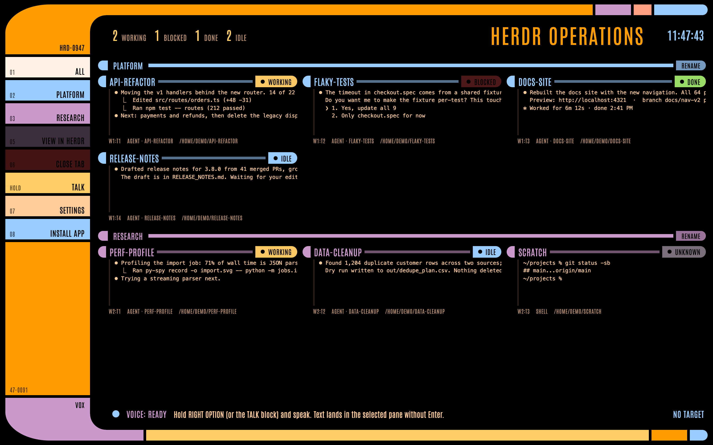
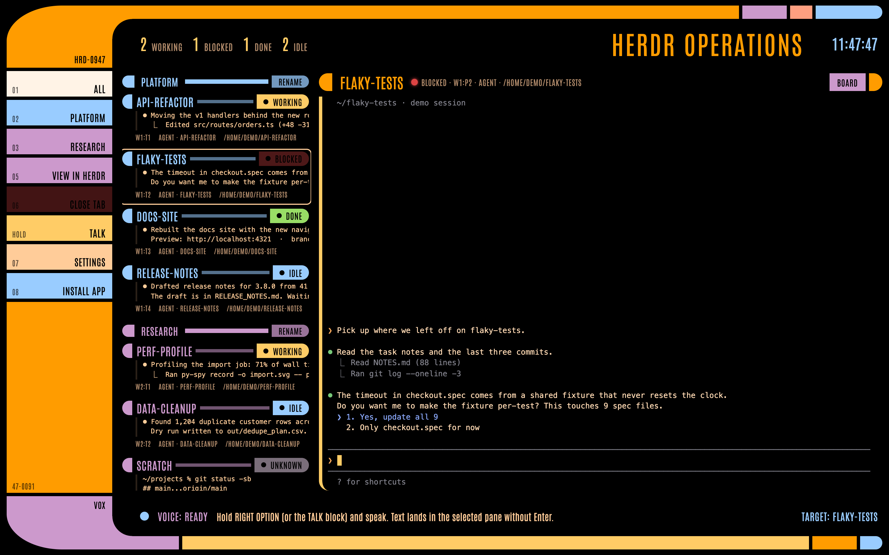

# LCARS for herdr

An LCARS-style (Star Trek computer look) control surface for [herdr](https://herdr.dev), the terminal workspace manager for AI coding agents. It runs on your Mac and adds push-to-talk voice to text, which runs fully locally on Apple Silicon's GPU.





*Screenshots use the built-in demo mode, so every agent and line of output is fictional.*

## What it does

- **Live agent board.** Every herdr tab is shown as a panel. Each has a status light (working, blocked, done, idle) and the agent's last few lines of output, and updates within about a second.
- **Interactive pane mirror.** Click a panel to drive that pane: type straight into it (keystroke to screen is about 30 ms), scroll with the mouse wheel, and click or drag inside an agent's input box the same way as in the herdr TUI. Multi-line pastes arrive in one piece. The view fills the window and keeps the bottom (latest output and the agent's input) in view.
- **Push-to-talk.** Hold Right Option, or the TALK block, and speak. whisper.cpp transcribes on the GPU (about 100 ms for a few seconds of speech), and the text lands in the selected pane's input without pressing Enter.
- **Sounds.** LCARS-style beeps for clicks, and alerts when an agent finishes or gets blocked. You can drop in your own sound files instead.
- **Workspace rename,** a settings panel, and installation as a standalone app with its own Dock icon.

## Requirements

- macOS. Apple Silicon is recommended; the voice model runs on Metal.
- [herdr](https://herdr.dev) 0.9.3 or later, with its server running.
- Python 3.12 or later, Node.js and npm, and Google Chrome.

## Quick start

```bash
git clone https://github.com/tanner49/lcars-herdr.git
cd lcars-herdr
ln -s "$PWD/bin/lcars" ~/.local/bin/lcars   # or anywhere on your PATH
lcars up
```

The first `lcars up` creates `.venv` (aiohttp, pywhispercpp, numpy) and runs `npm install` (xterm.js and the Antonio font). It also downloads the whisper `base.en` model (141 MB) into `models/`. It then starts the server on `127.0.0.1:7477` in the background and opens the app window. The first time you hold Right Option, Chrome asks for microphone access.

| Command | What it does |
|---|---|
| `lcars up` | Start the server if it isn't running, then open the window |
| `lcars down` | Stop the server |
| `lcars status` | Show whether it's running, plus port, PID and uptime |
| `lcars restart` | Down, then up |
| `lcars open` | Open the window only |
| `lcars install` | One time only: install LCARS as its own app (Dock icon, Cmd-Tab) |
| `lcars logs` | Follow `logs/server.log` |

**Try it without herdr:** `LCARS_DEMO=1 LCARS_PORT=7478 lcars up` runs a fictional session.

## Using it

| Action | Result |
|---|---|
| Click a panel | Open its pane mirror; the keyboard goes straight to the pane |
| Mouse wheel over the mirror | Shells scroll herdr's scrollback (typing jumps back to the bottom). Agents such as Claude Code get wheel events, so they scroll their own transcript |
| Click or drag in an agent pane | Sent to the agent as mouse events: click to move its cursor, drag to select. **Option-drag** selects locally so you can copy |
| Click or drag in a shell pane | Drag selects locally (Cmd-C copies). A click on the prompt line moves the cursor there |
| Hold **Right Option**, or the TALK block | Dictate into the selected pane (no Enter). Pressing another key while holding cancels |
| RENAME pill, or double-click a workspace | Rename the herdr workspace |
| VIEW IN HERDR | Switch the herdr TUI to this tab |
| CLOSE TAB | Close a plain shell tab, after a confirmation. Agent tabs are left to herdr |
| SETTINGS | Text size (always fills the space; − / + set a minimum), board list beside or hidden, talk key, mute, volume, agent alerts, click sounds |

Settings are saved to `settings.json`, which is git-ignored, and every open window shares them.

## Voice

Voice uses [whisper.cpp](https://github.com/ggml-org/whisper.cpp) through [pywhispercpp](https://github.com/absadiki/pywhispercpp)'s macOS arm64 wheel, with Metal enabled. Audio never leaves your machine: the page captures 16 kHz PCM with an AudioWorklet and posts it to the local server, which transcribes it and types the text into the pane through herdr. For better accuracy, download `ggml-small.en.bin` (466 MB) into `models/` and run `LCARS_WHISPER_MODEL=models/ggml-small.en.bin lcars restart`.

## Sounds

The built-in tones are synthesized in the page. To use your own, put audio files in `sounds/` named after the event:

| File | When it plays |
|---|---|
| `click-menu.wav` | Clicking a sidebar block |
| `click-panel.wav` | Opening an agent panel |
| `click-button.wav` | Clicking any other button |
| `done.wav` | An agent finishes |
| `blocked.wav` | An agent needs an answer |
| `talk-start.wav` / `talk-stop.wav` | Push-to-talk starts and stops |
| `error.wav` | An error message appears |

`.wav`, `.mp3`, `.ogg` and `.m4a` all work, and each control always plays the same sound. Audio files in `sounds/` are git-ignored, so this repo ships no sound recordings. See `sounds/README.md`.

## How it works

```
Chrome app window (static HTML/JS, xterm.js)
   │  WebSocket /ws: board, frames, input, actions          POST /api/transcribe: 16 kHz float32 PCM
   ▼
server.py — aiohttp on 127.0.0.1 (one Python process)
   ├─ board        session.snapshot every 1 s, plus events.subscribe for instant refresh
   ├─ previews     pane.read(visible) every 2 s, with agent-TUI chrome stripped
   ├─ mirror       pane.read(visible, ansi) for the watched pane: immediately after input, then every 8 ms
   │               for 1 s, otherwise every 50 ms; pushed only when it changes
   ├─ input        pane.send_text (raw bytes, bracketed pastes, SGR mouse reports) / pane.send_keys / pane.scroll
   └─ voice        whisper.cpp on Metal, model kept warm; result → pane.send_text (no Enter)
   │
   ▼  unix socket ~/.config/herdr/herdr.sock (newline-delimited JSON)
herdr server (unchanged)
```

herdr has no raw output stream and no attach API, and it doesn't report the cursor position. The mirror therefore redraws herdr's own rendered ANSI viewport and forwards raw keystrokes back. It infers the cursor from the prompt row and from your keystrokes. The details are in [docs/herdr-api-notes.md](docs/herdr-api-notes.md).

**Security.** The console can type into your terminals, so:
- the server binds `127.0.0.1` only;
- it checks `Host` (against DNS rebinding) and `Origin` (so no other website can drive it);
- every API and WebSocket call needs a random per-launch token, which is embedded in the page;
- there's no telemetry.

## Tests

Each test runs headless Chrome against the running server. It does its work in a throwaway herdr workspace (`lcars-tests`), which it deletes afterwards, and it never touches your own tabs.

```bash
.venv/bin/python tests/smoke.py        # guards, board, mirror, typing, voice → pane
.venv/bin/python tests/layout_ui.py    # mirror fills the window at Retina density, panes load, fixed sounds
.venv/bin/python tests/mouse_ui.py     # selection mapping, click-to-move, mouse reports to apps
.venv/bin/python tests/cursor_ui.py    # inferred cursor vs zsh's real cursor
.venv/bin/python tests/scroll_ui.py    # wheel scrollback, wheel into full-screen apps, bracketed paste
.venv/bin/python tests/settings_ui.py  # settings panel, alerts, custom sound files
.venv/bin/python tests/latency.py      # latency breakdown by stage
```

## Limitations and ideas

- Push-to-talk only works while the LCARS window has focus. A global hotkey needs a small native helper.
- The mirror shows only the visible rows (no scrollback of its own) and polls for changes. Both would improve if herdr added an output stream and cursor reporting.
- Possible next steps: answer a blocked agent's question straight from the board, macOS notifications, keyboard shortcuts to switch panes, and start at login.

## Credits and licence

MIT; see [LICENSE](LICENSE).
- [xterm.js](https://xtermjs.org) is MIT.
- [Antonio](https://fonts.google.com/specimen/Antonio) is under the SIL Open Font License 1.1.
- whisper.cpp and its models are MIT.
- The LCARS frame and the icon are original CSS and SVG.

*LCARS and Star Trek belong to CBS Studios / Paramount. This is an unofficial fan-made interface, not affiliated with or endorsed by them, and it includes no Star Trek artwork, logos, fonts or audio.*
